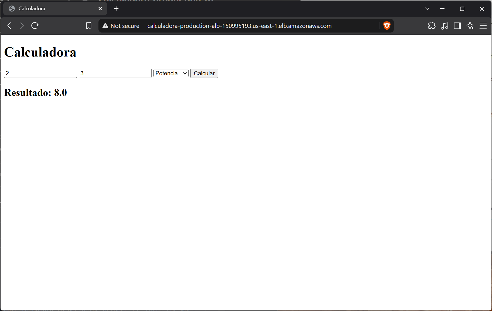
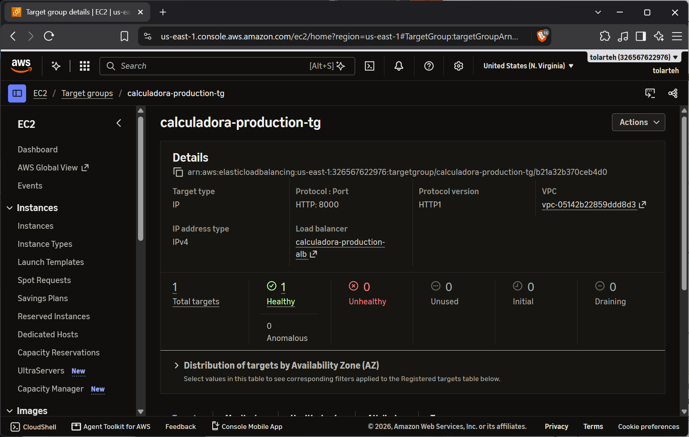

# Calculadora para CI/CD con Python

## Integrantes

Diego Sanchez Buitrago | Tomas Olarte Hernandez

**Dueño del repositorio:** Tomas Olarte Hernandez

## Evidencias

- URL de la ejecución del pipeline del merge de las nuevas funciones: https://github.com/tolarteh/cicd-pipeline-python-cd/actions/runs/43804801768
- URL del Pull Request de las nuevas funciones: https://github.com/tolarteh/cicd-pipeline-python-cd/pull/2
- Staging:    http://calculadora-staging-alb-1708230271.us-east-1.elb.amazonaws.com/
- Production: http://calculadora-production-alb-150995193.us-east-1.elb.amazonaws.com/

- 
- 

## Preguntas

1. Explica el flujo completo que implementaste (commit → `build-and-test` → `deploy-staging` → `test-staging` → aprobación → `deploy-production` → `smoke-test-production`). Sé *específico* sobre *qué artefacto se mueve entre los jobs, qué hace cada job y qué valida cada tipo de prueba*.

**R1:** El flujo comienza cuando un cambio llega a `main` por un PR aprobado. En el PR sólo ejecuta la parte de CI, ya los despliegues y pruebas adicionales se hacen únicamente en main.

- `build-and-test`: mismo CI que la vez anterior pero ignorando pruebas smoke. Construye la imagen de Docker, la prueba localmente con Selenium y la sube a DockerHub para luego poder hacer el despliegue, entrgando en la salida la `image_uri`. Este es el artefacto que viaja por todo el pipeline, sin reconstruirla.
- `deploy-staging`: se conecta a AWS y ejecuta Terraform en el workspace staging con el SHA como versión. Terraform crea o actualiza el clúster ECS Fargate, el servicio y el balanceador, entregando como salida la URL del balanceador de staging.
- `test-staging`: espera a que /health responda con el SHA nuevo y luego corre las pruebas de aceptación con Selenium contra el último staging.
- `deploy-production`: después de aprobación manual, de hace lo mismo que en el deploy anterior pero apuntando al workspace de production.
- `smoke-test-production`: espera a que producción reporte el nuevo SHA y corre pruebas de humo rápidas mirando que cargue la página principal con código 200, que diga Calculadora y que /health diga ok con la versión correcta. No hace operaciones en producción.

Además, cada job de pruebas guarda su reporte HTML como artefacto de GitHub Actions.

2. ¿Qué ventajas y desventajas encontraste al usar Terraform en vez de crear la infraestructura manualmente desde la consola? ¿Por qué el estado de Terraform se guarda en un bucket S3 y no en tu computador?

**R2:** la mayor **ventaja** es hacer la infraestructura como código, para repetibilidad y evitar configuraciones manuales sujetas a errores humanos. Otra ventaja es que se integra en el pipeline de GitHub Actions, por lo que podemos automatizar también el CD. Por último destruir con un comando evita dejar recursos olvidados (muy común configurando a mano).

Como **desventajas**, veo que toca aprender una herramienta nueva, los errores del init son confusos (nos falló en PowerShell y no encontramos fácil por qué). También, si alguien cambia a mano algo en consola, la realidad deja de coincidir.

El estado debe estar disponible para el pipeline de GitHub Actions, entonces no sirve en mi computador. Ya que estamos en AWS un lugar natural es un bucket con la permisología adecuada.

3. ¿Qué ventajas y desventajas tiene introducir un entorno de Staging en el pipeline de despliegue a AWS? ¿Cómo impacta esto la velocidad vs. la seguridad del despliegue?

**R3:** Como **ventajas** podemos probar manualmente o con un equipo de QA/Usuarios el ambiente sin afectar producción. Toda la infraestructura es igual que en producción en este caso. También nos permite automatizar pruebas y encontrar errores que no salen sin desplegar (los runners pueden no tenerlo), como configuración de red, balanceadores entre otras.
Como **desventajas**, cuesta más (o el doble) dependiendo de la segunda copia de la infraestructura, el pipeline se retrasa y hay que mantener dos ambientes parecidos juntos con el esfuerzo de evitar que se separen.

La velocidad de despliegue disminuye a cambio de la seguridad de que capturamos errores de infraestructura y pruebas más exhaustivas en un ambiente antes de pasar a producción.

4. ¿Qué diferencia hay entre las pruebas ejecutadas contra Staging (`test-staging`) y las ejecutadas contra Producción (`smoke-test-production`) en tu pipeline? ¿Por qué esta diferencia?

**R4:** La diferencia está en lo exhaustivas que se hacen las pruebas de staging, porque incluyen pruebas de aceptación automatizadas + pruebas manuales posteriores. En producción sólo reviso que todo se cargue correctamente y se evitan pruebas exhaustivas por varias razones: a) ya se acabaron de probar en staging, repetir sólo demoraría el proceso sin mejoras adicionales y b) las pruebas podrían generar datos falsos o carga innecesaria frente a usuarios reales que podrían percibir que hay problemas por la latencia o datos extraños. Lo que podría hacer en producción es un usuario netamente para pruebas e intentar algunas de las pruebas ahí.

5. Considerando un ciclo completo de DevOps, ¿qué partes importantes (fases, herramientas, prácticas) crees que aún le faltan a este pipeline de CI/CD que has construido? (Menciona 2, explica por qué son importantes y cómo podrían implementarse brevemente).

**R5:** Faltarían 2. Monitoreo junto a alertas y escaneos de seguridad. En la primera (monitoreo) nos ayuda a expandir el health check por datos de latencia y otras métricas de tecnología y negocio para ver en los logs y dashboards si el cambio empeoró alguna propiedad de la aplicación que queremos conservar. Por ejemplo se puede usar CloudWatch en este caso y notificaciones por correo cuando haya errores, uso alto de CPU, latencias por encima de lo esperado. El segundo (escaneos de seguridad) nos faltó escanear la imagen de Docker justo después de construir la imagen y antes de subirla a DockerHub.

6. ¿Cómo les pareció implementar las dos funcionalidades nuevas con el pipeline completo? ¿Encontraron útil el CI/CD al hacer cambios y despliegues? ¿Qué no fue tan útil? **Cada integrante** responde con su experiencia propia, identificándose con su nombre.

**R6:** [Diego Sanchez] Me gustó y me retó, porque en mis proyectos personales no tengo un ciclo de despliegue controlado y la observabilidad se reduce al monitoreo de las instancias que uso. Lo más útil fue que el pipeline detectó un problema que no vi localmente: las pruebas pasaban en mi equipo, pero fallaron en Staging porque Chrome bloqueaba el ALB por HTTP. Lo menos útil fue el tiempo de espera de cada ejecución y los fallos de configuración que no tenían que ver con el código. En mi trabajo uso Sonar y Veracode, así que el análisis estático me resultó familiar; me gustaría profundizar en cómo funciona Sonar a nivel interno.

[Tomas Olarte] Implementar las funcionalidades con el pipeline completo me dio tranquilidad. Cada cambio pasaba por las mismas pruebas, el análisis de SonarCloud y el despliegue a staging sin pasos manuales, y si algo fallaba, producción no se tocaba. Lo más útil fue que SonarCloud nos obligó a fijar las acciones de GitHub por SHA y a instalar las dependencias con hashes, prácticas de seguridad que no habría aplicado por mi cuenta. También fue útil que la aprobación manual nos obligó a coordinarnos como equipo antes de pasar a producción. Lo menos útil, o lo que más costó, fue la configuración inicial: sin acceso a AWS Academy tuve que crear una cuenta propia, el rol y el usuario de IAM, y resolver errores de Terraform en PowerShell. Además, cada ciclo del pipeline tarda varios minutos, así que depurar es lento comparado con probar en local.

7. Con la aprobación manual, ¿su pipeline implementa Entrega Continua o Despliegue Continuo? ¿Por qué? ¿Qué revisaron en Staging antes de aprobar el paso a Producción? Si una versión nueva no lograra pasar el health check, ¿qué haría ECS y cómo lo detectaría el pipeline?

**R7:** Con la aprobación manual quedó en Entrega Continua, porque para pasar a producción alguien del equipo tiene que dar el visto bueno explícito en la plataforma. En staging revisamos las operaciones nuevas con 2 ejemplos en cada una.

Si una versión nueva falla en /health, el balanceador no le enviaría tráfico. Como el servicio está configurado con un `minimum_healthy_percent = 100`, la tarea anterior sigue atendiendo mientras. ECS intenta reemplazar la tarea que falla, pero si sigue fallando tenemos `rollback = true` para que vuelva a la versión anterior si ECS marca el despligue como fallido. El pipeline lo detecta en el paso que espera la versión nueva, durante 5 minutos consulta /health buscando el SHA del commit, si no aparece en el job sale fallido por "La versión $GITHUB_SHA no quedó desplegada a tiempo".
